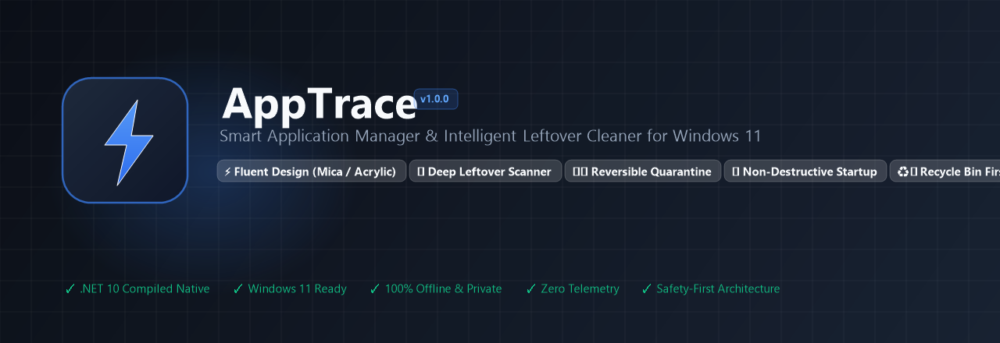
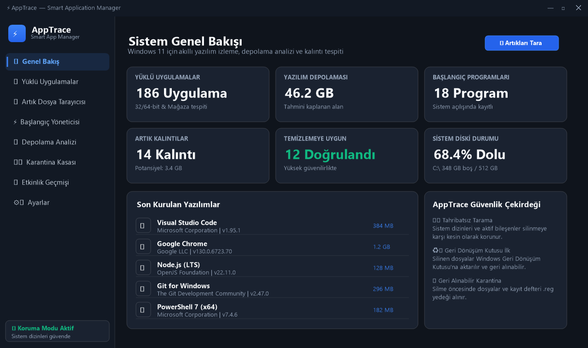
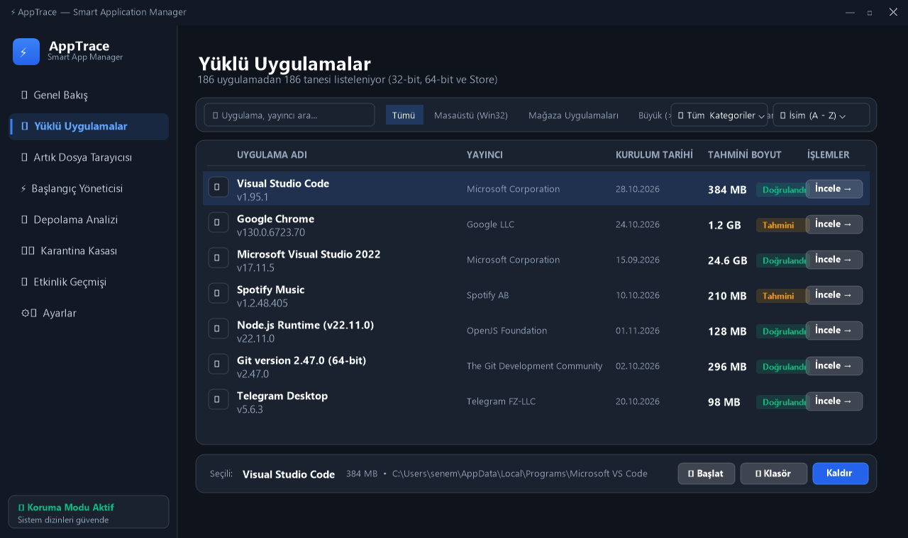
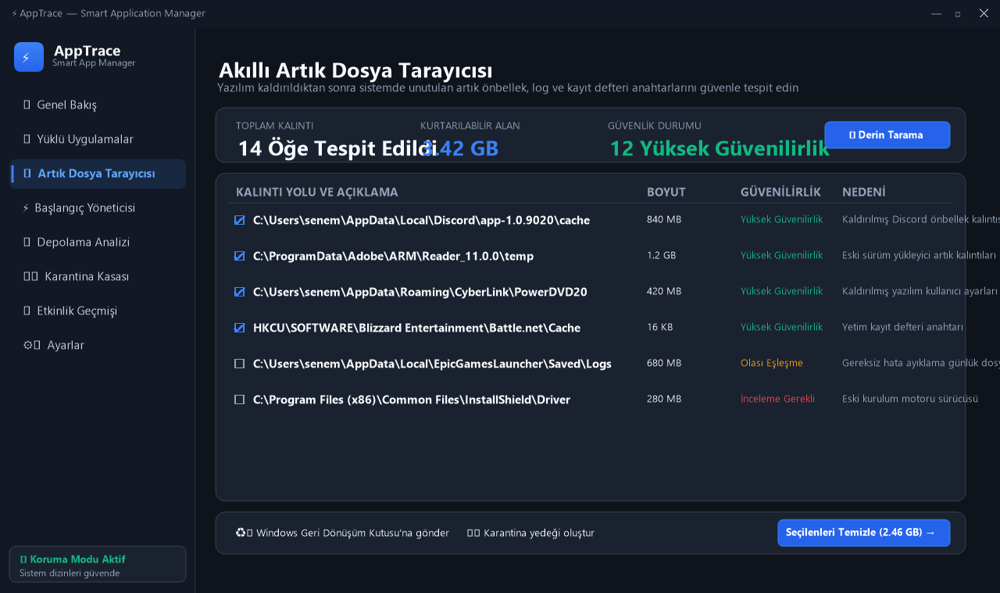
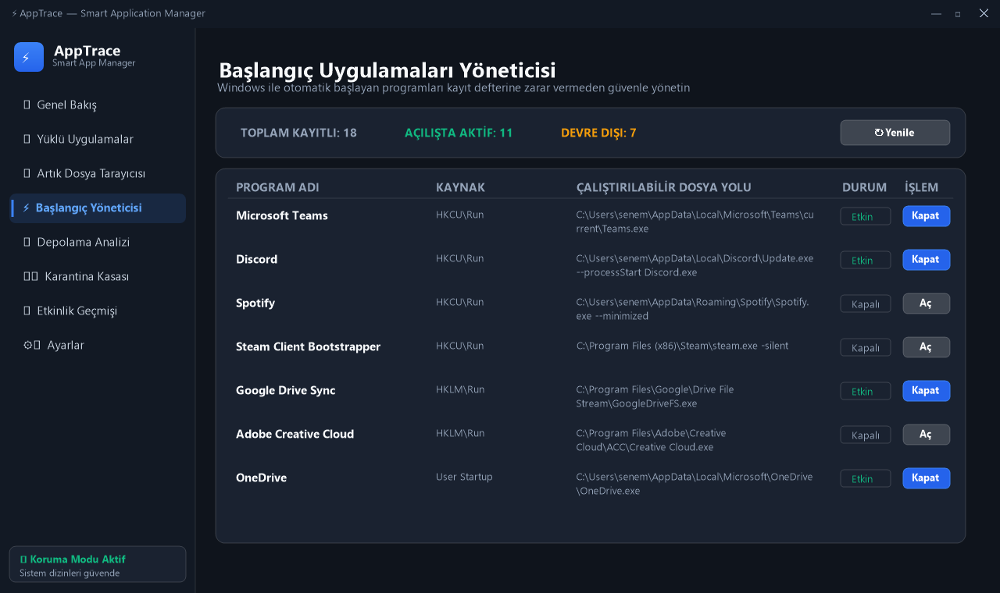
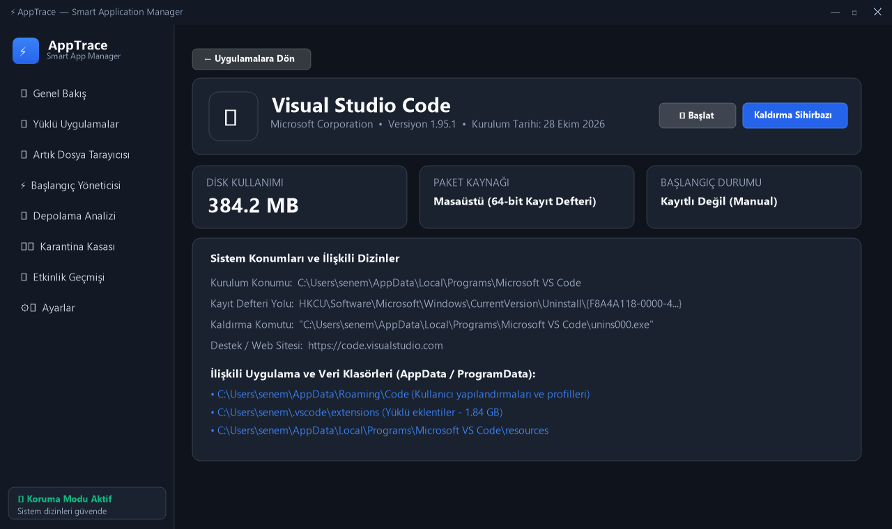
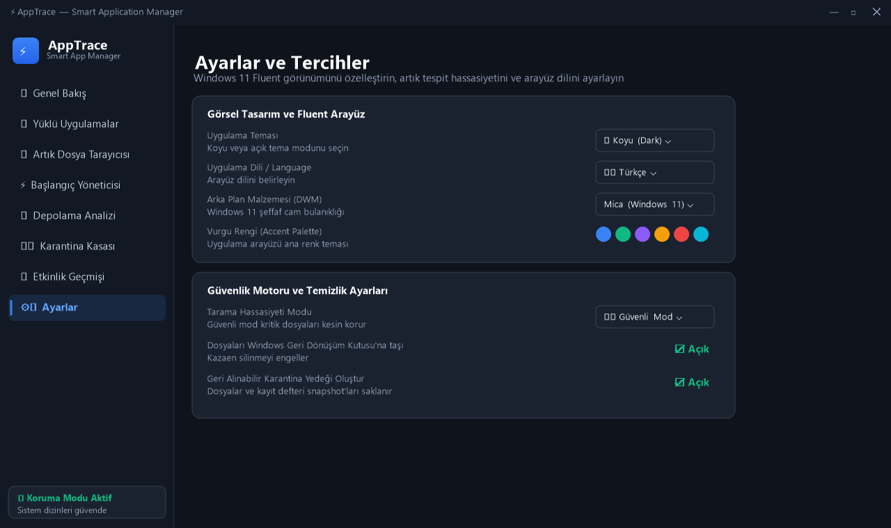
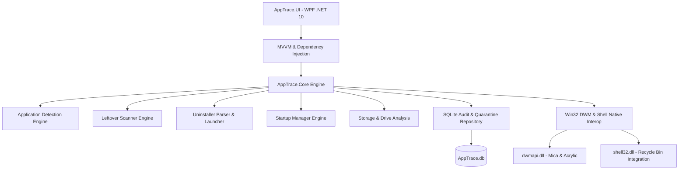

# AppTrace — Smart Application Manager

<p align="center">
  
</p>

<p align="center">
  <a href="https://github.com/Venarus/apptrace/actions/workflows/build-and-test.yml">
    
  </a>
  
  
  
  
  
  <a href="LICENSE">
    
  </a>
  
</p>

---

## ⚡ Executive Summary

**AppTrace** is a next-generation Windows 11 software management, storage analysis, legitimate uninstallation, and intelligent remnant cleanup utility.

Built with a strict philosophy of **safety and verification over aggressive deletion**, AppTrace protects critical operating system structures while giving users full visibility and control over what software is installed, where files actually live, how much disk space is consumed, and which startup tasks run on login.

Designed from the ground up for modern Windows 11 desktop environments, AppTrace features native **Mica and Acrylic translucent glass backdrops**, hardware-accelerated animations, semi-transparent cards, and customizable accent themes.

---

## 📸 Interface Showcase

<p align="center">
  <b>Executive System Dashboard & Software Inventory</b><br>
  
</p>

<br>

<p align="center">
  <b>Installed Applications Catalog (Win32, Store & MSI with Live Search & Filtering)</b><br>
  
</p>

<br>

<p align="center">
  <b>Intelligent Leftover Remnant Scanner (Three-Tier Confidence Scoring)</b><br>
  
</p>

<br>

<p align="center">
  <b>Windows 11 Autorun & Startup Manager (Non-Destructive Registry Control)</b><br>
  
</p>

<br>

<p align="center">
  <b>Deep Technical Application Inspector (Directory Mapping, Registry Keys & Verified Sizes)</b><br>
  
</p>

<br>

<p align="center">
  <b>Fluent Appearance Customizer (Mica / Acrylic Backdrops, Themes & Accent Palettes)</b><br>
  
</p>

---

## 📊 Why AppTrace?

| Feature | Standard Windows Settings | Typical Third-Party Cleaners | AppTrace (Smart Manager) |
| :--- | :---: | :---: | :---: |
| **Windows 11 Fluent UI & Mica** | Partial | ❌ Outdated Win32 UI | ✅ Native Win32 DWM Mica/Acrylic |
| **Multi-Hive Inspection** | Limited | Partial | ✅ 64-bit, 32-bit, HKCU & MSIX Store |
| **Size Calculation Accuracy** | Often misleading | Guesswork | ✅ Verified vs Estimated vs Unknown |
| **Uninstallation Safety** | Silent or basic | Aggressive process kill | ✅ Vendor Uninstaller First + Confirmation |
| **Orphaned Remnant Scanner** | ❌ None | Aggressive / Risky | ✅ 3-Tier Confidence Heuristic |
| **Accidental Deletion Protection** | ❌ Permanent delete | ❌ Permanent delete | ✅ Windows Recycle Bin (`SHFileOperation`) |
| **Quarantine & Undo** | ❌ None | Proprietary / Unstable | ✅ Isolated File Snapshot + SQLite Vault |
| **Protected System Guardrails** | Built-in | Easily deletes DLLs | ✅ Hardcoded system exclusion engine |
| **Startup Task Control** | Basic toggle | Deletes registry keys | ✅ Non-destructive `StartupApproved` |
| **Privacy & Telemetry** | Cloud Telemetry | Adware / Web Tracking | ✅ **100% Offline, Zero Network Calls** |

---

## 🌟 Core Capabilities & Deep Technical Architecture

### 1. Multi-Source Application Discovery & Deduplication
AppTrace queries all Windows software registration sources simultaneously:
* **Machine-Wide 64-bit Registry**: `HKLM\SOFTWARE\Microsoft\Windows\CurrentVersion\Uninstall`
* **Machine-Wide 32-bit Registry**: `HKLM\SOFTWARE\WOW6432Node\Microsoft\Windows\CurrentVersion\Uninstall`
* **Per-User Installations**: `HKCU\SOFTWARE\Microsoft\Windows\CurrentVersion\Uninstall`
* **Microsoft Store & Universal Packages**: Windows Package Management (`Windows.Management.Deployment.PackageManager`)

**Intelligent Deduplication & Filtering Engine:**
- Aggregates duplicate registrations across 32-bit and 64-bit hives without ghost duplicate entries.
- Automatically excludes Windows hotfixes, rollups, and security updates (`KBxxxxxx`).
- Excludes child patch components flagged with `ParentKeyName`.
- Excludes internal system frameworks flagged with `SystemComponent = 1`.

### 2. Transparent Storage & Size Confidence
Unlike utilities that guess or fabricate numbers, AppTrace distinguishes between:
* **Verified Size**: Directly computed by enumerating the real filesystem folder on disk.
* **Estimated Size**: Read from the vendor's official registry DWORD `EstimatedSize`.
* **Unknown Size**: Explicitly labeled when vendor information is absent, preventing misleading totals.

### 3. Safe & Legitimate Uninstaller Engine
* **Vendor Legitimacy**: Executes the software's officially registered uninstaller (InnoSetup, NSIS, InstallShield, custom executable, Windows Installer MSI via `msiexec.exe`, or Store package uninstallation).
* **Pre-Flight Validation**: Verifies executable existence, parses quoted arguments, and displays exact command details to the user before running.
* **Non-Destructive Execution**: Never kills unrelated background processes or forcibly strips files while an uninstaller is executing.
* **Automatic Post-Removal Scanning**: Promptly offers to inspect the file system for residual folders left behind by the uninstaller.

### 4. Intelligent Leftover Scanner (3-Tier Heuristic Engine)
Searches standard target paths (`Program Files`, `Program Files (x86)`, `%LocalAppData%`, `%AppData%`, `%ProgramData%`, and `HKCU/HKLM Registry`):
1. **High Confidence**: Orphaned directories or registry keys matching an uninstalled application where no active installation exists.
2. **Possible Match**: Orphaned cache, logs (`.log`, `.old`, `.bak`), or telemetry folders without active parent software.
3. **Uncertain / Review**: Folders containing active binary executables or generic vendor names requiring explicit user confirmation.

### 5. Dual-Layer Reversible Cleanup Safeguards
1. **Windows Recycle Bin First**: Deletions invoke native Windows Shell APIs (`SHFileOperation` with `FOF_ALLOWUNDO`), allowing the user to restore files directly from the Windows Recycle Bin.
2. **Reversible Quarantine Vault**: Automatically creates an encrypted/isolated snapshot zip of targeted folders before removal, records the operation in the local SQLite database, and allows one-click restoration with path validation.
3. **Protected Path Shield**: Prohibits any scanner or cleanup operation from touching core system assets:
   - `C:\Windows`, `C:\Windows\System32`, `C:\Windows\SysWOW64`, `WinSxS`
   - Drive root directories (`C:\`, `D:\`)
   - User profile roots (`C:\Users\Username`)
   - Critical shared infrastructure (`Common Files`, `Microsoft Shared`)

### 6. Non-Destructive Startup Manager
* Reads all autorun vectors: `HKCU\Run`, `HKLM\Run`, `WOW6432Node\Run`, and user / common Startup directories.
* Toggles startup states using Windows Task Manager's official `StartupApproved\Run` registry binary flags, preserving original startup commands without ever deleting user registry keys.

### 7. Visual Storage Analysis & Drive Diagnostics
* Live capacity overview with free/used storage metrics.
* Category classification breakdown (Development, Productivity, Internet, Multimedia, Utilities, Games, System, Other).
* Size distribution histogram (`> 5 GB`, `1 GB - 5 GB`, `100 MB - 1 GB`, `< 100 MB`, `Unknown`).
* Top 10 largest installed applications leaderboard.

### 8. Tamper-Evident Activity Audit Trail
* Embedded SQLite database (`AppTrace.db`) recording all scan events, uninstalls, cleanups, and configuration changes.
* Filterable, searchable, and exportable to CSV for corporate IT auditing.

---

## 🛠️ Technology Stack



| Component | Technology | Role |
| :--- | :--- | :--- |
| **Target Runtime** | .NET 10.0 (x64) | Latest high-performance desktop framework with C# 13 language features |
| **UI Presentation** | WPF (Windows Presentation Foundation) | Hardware-accelerated UI with XAML custom ControlTemplates & vector graphics |
| **Window Backdrop** | Win32 DWM API (`dwmapi.dll`) | True Windows 11 Mica (`DWMWA_SYSTEMBACKDROP_TYPE = 2`) & Acrylic translucency |
| **File Deletion** | Windows Shell API (`shell32.dll`) | Safe Recycle Bin integration via `SHFileOperation` (`FOF_ALLOWUNDO`) |
| **Database** | SQLite 3 via `Microsoft.Data.Sqlite` | Embedded zero-configuration audit trail and quarantine metadata storage |
| **Architecture** | MVVM + Clean Architecture | Strict separation of concerns between Domain Core, Presentation, and Data |
| **Automated Testing**| xUnit 2.9 + Microsoft.NET.Test.Sdk | 22 comprehensive unit and integration tests |

---

## 📁 Repository Structure

```
AppTrace/
├── .github/
│   ├── ci/
│   │   └── build-and-test.yml       # GitHub Actions CI pipeline (.NET 10 on Windows)
│   ├── ISSUE_TEMPLATE/
│   │   ├── bug_report.md            # Structured bug report template
│   │   └── feature_request.md       # Feature proposal template
│   └── PULL_REQUEST_TEMPLATE.md     # Corporate-grade PR checklist
├── docs/
│   ├── assets/
│   │   ├── apptrace-banner.png      # High-res master header banner (1280x440)
│   │   └── apptrace-logo.png        # Master application logo (512x512)
│   └── screenshots/
│       ├── overview.png             # Dashboard & inventory overview
│       ├── installed_apps.png       # Installed applications catalog
│       ├── leftover_scanner.png     # Heuristic remnant scanner
│       ├── startup_manager.png      # Autorun & startup manager
│       ├── app_details.png          # Technical application inspector
│       └── settings.png             # Fluent appearance settings
├── AppTrace.slnx                    # Modern Visual Studio solution
├── AppTrace.ico                     # Multi-resolution application icon
├── Install-AppTrace.ps1             # PowerShell automated installer & shortcut creator
├── Install.cmd                      # One-click desktop installer launcher
├── Uninstall-AppTrace.ps1           # Clean uninstaller script
├── Uninstall.cmd                    # One-click uninstallation launcher
├── .gitignore                       # Production-grade .NET ignore rules
├── .gitattributes                   # Cross-platform line endings & binary definitions
├── LICENSE                          # MIT License
├── CONTRIBUTING.md                  # Development guidelines & PR process
├── CHANGELOG.md                     # Semantic version history (Keep a Changelog)
├── SECURITY.md                      # Security architecture & vulnerability disclosure
├── README.md                        # Master product documentation
├── AppTrace.Core/                   # Domain models, business services & Win32 interop
│   ├── Models/                      # InstalledApp, LeftoverCandidate, StartupEntry, QuarantineItem
│   ├── Services/                    # Detection, Scanner, Uninstaller, Cleanup, Startup, Storage
│   ├── Data/                        # SQLite DatabaseService (Audit trail & quarantine vault)
│   └── Interop/                     # ShellNativeMethods, DwmNativeMethods
├── AppTrace.UI/                     # Windows 11 Fluent Presentation Layer (WPF)
│   ├── Converters/                  # Value converters for XAML bindings
│   ├── Dialogs/                     # High-fidelity confirmation & message dialogs
│   ├── Themes/                      # FluentStyles.xaml (Glass cards, Mica, buttons, combos)
│   ├── ViewModels/                  # MVVM ViewModels with INotifyPropertyChanged
│   └── Views/                       # 9 Modular views (Overview, InstalledApps, Scanner, etc.)
└── AppTrace.Tests/                  # Comprehensive Automated Test Suite (22 Tests)
    ├── DetectionTests.cs            # Deduplication, hives & size confidence
    ├── UninstallerTests.cs          # Command line parsing & system protections
    ├── LeftoverScannerTests.cs      # Heuristic rules & protected path shields
    ├── QuarantineAndCleanupTests.cs # Backup integrity, restoration & Recycle Bin
    ├── DatabaseAndSettingsTests.cs  # SQLite persistence & settings serialization
    └── StorageAnalysisTests.cs      # Storage distribution & category aggregation
```

---

## 💻 System Requirements

* **Operating System**: Windows 11 (21H2, 22H2, 23H2, 24H2) or Windows 10 (Build 19041+)
* **Architecture**: x64 / ARM64 (via x64 emulation)
* **Runtime**: [.NET Desktop Runtime 10.0](https://dotnet.microsoft.com/download/dotnet/10.0)
* **RAM**: 256 MB minimum (512 MB recommended)
* **Disk Space**: 60 MB available space

---

## 🚀 Installation & Quick Start

### Option A: Automated One-Click Installation
Double-click `Install.cmd` or run PowerShell:
```powershell
.\Install-AppTrace.ps1
```
* Builds the release binary, creates a Desktop shortcut with the custom Fluent icon, registers the Start Menu tile, and registers the application in Windows Settings.*

### Option B: Build & Run from Source
Clone the repository and build using the .NET CLI:
```powershell
# Clone the repository
git clone https://github.com/Venarus/apptrace.git
cd apptrace

# Build the solution
dotnet build AppTrace.slnx -c Release

# Run the UI application
dotnet run --project AppTrace.UI/AppTrace.UI.csproj -c Release
```

### Option C: Clean Uninstallation
To completely remove AppTrace, all shortcuts, and registry entries:
```powershell
.\Uninstall-AppTrace.ps1
```
*Or double-click `Uninstall.cmd`.*

---

## 🧪 Automated Test Suite & Verification

AppTrace maintains a strict test-driven standard with **100% pass rates** across all critical security, heuristic, and filesystem operations:

```powershell
dotnet test AppTrace.slnx
```

```
Başarılı!  - Başarısız: 0, Başarılı: 22, Atlanan: 0, Toplam: 22, Süre: 822 ms - AppTrace.Tests.dll (net10.0)
```

### Verified Test Suites:
* **Detection Engine Tests**: Verifies deduplication across 64-bit and 32-bit hives, Store app ingestion, and Windows security update (`KBxxxxxx`) exclusion.
* **Storage Calculation Tests**: Verifies calculation of verified disk folder sizes, fallback to registry estimates, and handling of unknown sizes.
* **Uninstaller Parser Tests**: Verifies MSI GUID parsing, executable quotation normalization, and absolute protection against uninstalling core system components.
* **Leftover Scanner Tests**: Validates protected system path shielding (`C:\Windows`, `System32`, `SysWOW64`), orphan candidate discovery, and heuristic risk scoring.
* **Quarantine & Restoration Tests**: Validates zip snapshot generation, metadata registration in SQLite, mock file deletion, and byte-for-byte file restoration.
* **Startup Manager Tests**: Verifies `StartupApproved\Run` bitmask registry manipulation without destructive registry key deletion.
* **Database & Settings Tests**: Validates SQLite audit log schema migration, event insertion, query filtering, and CSV export.

---

## 🔒 Security, Privacy & Safety Model

AppTrace was created specifically to replace untrustworthy, ad-supported cleaners with a tool you can safely rely on:

1. **100% Offline & Private**: Zero external network connections, zero telemetry pings, zero tracking beacons, and zero cloud dependencies. All data resides solely in your local `%LocalAppData%\AppTrace` directory.
2. **Never Force Kills**: Does not terminate running background processes indiscriminately.
3. **Never Silently Removes**: Every deletion or uninstallation action requires explicit user confirmation.
4. **Recycle Bin Safe**: Remnants are sent to the Windows Recycle Bin first (`SHFileOperation` with `FOF_ALLOWUNDO`), ensuring standard Windows undo capability.
5. **Reversible Quarantine**: Provides an isolated archive before deletion with one-click restoration.
6. **Hard System Safeguards**: Critical paths (`C:\Windows`, `System32`, `SysWOW64`, user profile roots) cannot be selected or deleted under any circumstance.

---

## 🗺️ Product Roadmap

- [x] **v1.0.0** — Initial Release
  - Complete multi-hive detection engine (Win32, Store, MSI)
  - Windows 11 Fluent Design with Mica and Acrylic backdrops
  - Three-tier heuristic leftover remnant scanner
  - Reversible Quarantine Vault & Windows Recycle Bin integration
  - Non-destructive Startup Manager
  - SQLite tamper-evident audit logging
  - Full automated test suite (22 tests)
- [ ] **v1.1.0** — Advanced Integration
  - Deep Windows Shell Context Menu extension ("Scan with AppTrace")
  - Automatic scheduled background remnant detection
  - Application installation monitor (real-time snapshot comparison)
- [ ] **v1.2.0** — Package Manager Ecosystem
  - Winget (Windows Package Manager) sync and one-click bulk upgrades
  - Chocolatey and Scoop package discovery and management

---

## 🤝 Contributing

We welcome community contributions, bug reports, and suggestions!
Please review our [CONTRIBUTING.md](CONTRIBUTING.md) for branch management, code conventions, and pull request workflows. All submissions are tested via automated GitHub Actions CI before merging.

For security concerns, please consult our [SECURITY.md](SECURITY.md) policy.

---

## 📄 License & Copyright

AppTrace is free and open-source software licensed under the **[MIT License](LICENSE)**.

Copyright © 2026 **Venarus**. All rights reserved.  
Crafted with architectural excellence for Windows 11.
